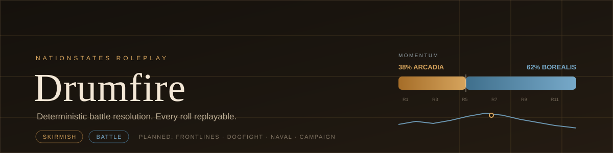
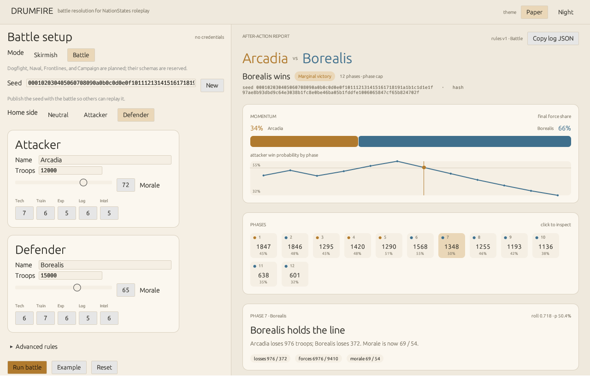
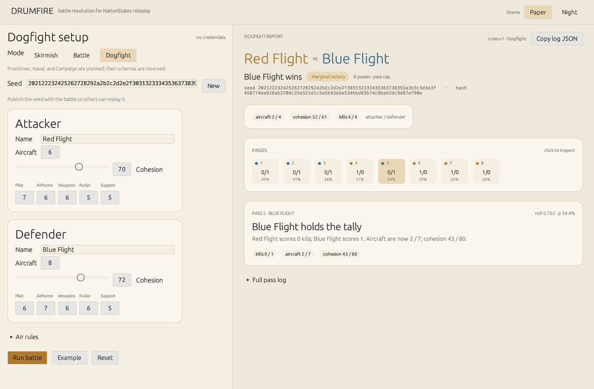
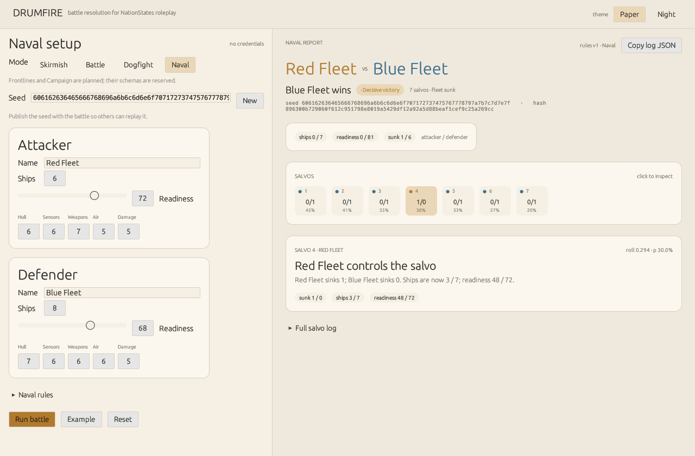
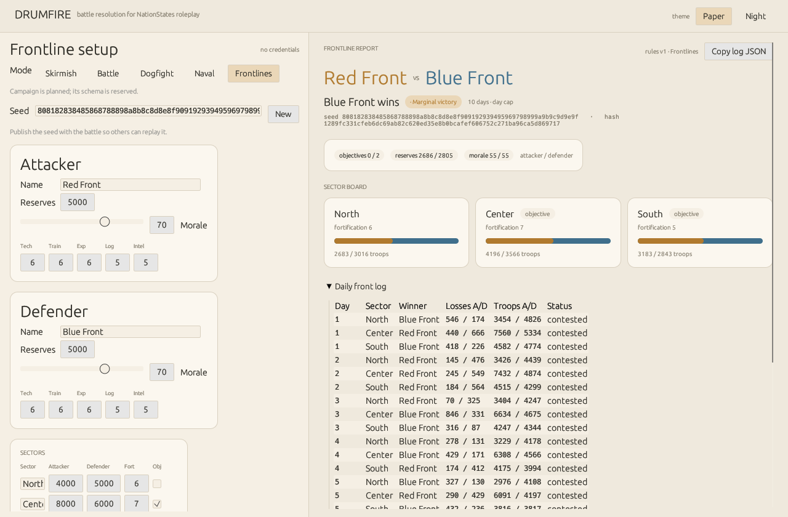
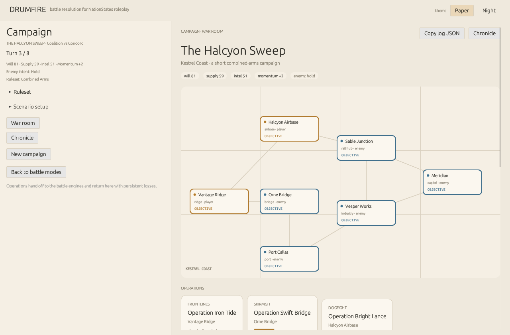

# Drumfire

<div align="center">



**Deterministic battle resolution for NationStates roleplay.**

<br />

<!-- Tier 1: project metadata -->
<p align="center">
  <a href="https://github.com/LeTrollologist/Drumfire/releases">
    
  </a>
  <a href="crates/">
    
  </a>
  <a href="docs/modes.md">
    
  </a>
  <a href="crates/core/">
    
  </a>
  <a href="LICENSE">
    
  </a>
  <a href="docs/nationstates.md">
    
  </a>
  <a href="SECURITY.md">
    
  </a>
</p>

<!-- Tier 2: runtime and delivery -->
<p align="center">
  
  &nbsp;
  
  &nbsp;
  
  &nbsp;
  
</p>

<!-- Tier 3: quick navigation buttons -->
<p align="center">
  <a href="#quick-start">
    
  </a>
  &nbsp;
  <a href="docs/modes.md">
    
  </a>
  &nbsp;
  <a href="docs/rules.md">
    
  </a>
  &nbsp;
  <a href="docs/nationstates.md">
    
  </a>
  &nbsp;
  <a href="SECURITY.md">
    
  </a>
</p>

</div>

**Status:** Phase 11 — all five battle modes plus the seven-node **Halcyon Sweep**
campaign, now with a scenario ruleset: editable city and formation names, forts,
garrisons, starting resources, module toggles, and NationStates capital import.
Deterministic core, CLI, egui desktop UI, and read-only NationStates data. No
account login, no write actions, no credentials.

<div align="center">
  
</div>

> Drumfire is an independent project. It is not affiliated with, endorsed by, or
> operated by NationStates or Max Barry.

Drumfire is a from-scratch Rust successor to the abandoned
[NationStatesBattleSim](https://github.com/GhostlyBanjo/NationStatesBattleSim).
It keeps the original idea — a quick, transparent way to resolve a roleplayed
battle — and replaces the broken 2015 Java prototype with a small, tested,
replayable engine.

---

## Why this exists

The original simulator took seven factors per side — force count, morale,
technology, training, combat experience, logistics, and intel — plus home
advantage, and tried to produce a winner. The idea was good. The implementation
was not: its default branch contains committed merge-conflict markers, cannot
compile, freezes after “Run,” and uses integer division that erases most
advantages.

Drumfire starts over with three rules:

1. **Invalid inputs cannot enter the engine.** Force counts are non-zero,
   ratings are 1–10, morale is 0–100, and at most one side can be the home team.
2. **Every battle is reproducible.** Randomness comes from a published 32-byte
   seed. The log embeds the input; `drumfire replay` re-runs it and verifies the
   result.
3. **The math is documented.** No hidden “balance” constants in a UI file; see
   [`docs/rules.md`](docs/rules.md).

---

## Build

Requires Rust 1.85 or newer.

```sh
cargo build --release
cargo test
```

| Target | Requirements |
|---|---|
| Windows | MSVC Rust toolchain; no WebView or Node needed (egui uses OpenGL). |
| Linux | A working X11/Wayland + OpenGL stack and the usual egui/winit development packages (X11, Wayland, xkbcommon, GL). |

The binaries are `target/release/drumfire` (CLI) and
`target/release/drumfire-gui` (desktop).

## Quick start

### CLI

```sh
cargo run -p drumfire-cli -- run fixtures/example.json
```

```text
Battle: Arcadia (attacker) vs Borealis (defender)
Seed: 000102030405060708090a0b0c0d0e0f101112131415161718191a1b1c1d1e1f
Input hash: 97ae8b93dbd9c64e3038b1fc8e0be46ba05b1fddfe1006065847cf65b824702f

Phase  1: attacker p= 45.0% roll=0.414  losses    531/1316  forces   11469/13684  morale  77/58
...
Result: Borealis — Marginal victory after 12 phases.
Ending: phase cap.
Final forces: 3895 / 7668
Final morale: 32 / 76
```

Skirmish mode uses the same ground family with a smaller-unit profile:

```sh
cargo run -p drumfire-cli -- run fixtures/skirmish.json
```

Dogfight mode uses its own air-combat schema:

```sh
cargo run -p drumfire-cli -- air run fixtures/dogfight.json
cargo run -p drumfire-cli -- air replay fixtures/dogfight.log.json
```

<div align="center">
  
</div>

Naval mode uses its own fleet schema:

```sh
cargo run -p drumfire-cli -- naval run fixtures/naval.json
cargo run -p drumfire-cli -- naval replay fixtures/naval.log.json
```

<div align="center">
  
</div>

Frontlines mode uses a sector-and-reserves schema:

```sh
cargo run -p drumfire-cli -- frontline run fixtures/frontline.json
cargo run -p drumfire-cli -- frontline replay fixtures/frontline.log.json
```

<div align="center">
  
</div>

Campaign mode chains operations into one persistent war:

```sh
cargo run -p drumfire-cli -- campaign scenario --out scenarios/my-war.json
cargo run -p drumfire-cli -- campaign demo --scenario scenarios/my-war.json
cargo run -p drumfire-cli -- campaign play
cargo run -p drumfire-cli -- campaign replay fixtures/campaign.log.json
```

The built-in campaign is **The Halcyon Sweep**. Its scenario file is
[`scenarios/kestrel-coast.json`](scenarios/kestrel-coast.json): city names,
formations, forts, garrisons, starting resources, and ruleset modules are
editable. The GUI exposes the same values as text fields and sliders under
**Ruleset** and **Scenario setup**. NationStates `capital` and `customcapital`
shards provide the capital name for imported nations.

Full design: [`docs/campaign.md`](docs/campaign.md). Scenario schema:
[`docs/scenario.md`](docs/scenario.md).

<div align="center">
  
</div>

The war room includes the paper map, resource and formation rails, operation
briefings, after-action reports, and the campaign chronicle. Run the GUI with:

```sh
cargo run -p drumfire-gui -- --demo-campaign
```

Override the mode on any input:

```sh
cargo run -p drumfire-cli -- run fixtures/example.json --mode skirmish
cargo run -p drumfire-cli -- explain fixtures/example.json --mode skirmish
```

Inspect the strength model before rolling:

```sh
cargo run -p drumfire-cli -- explain fixtures/example.json
```

Save a self-contained log and verify it later:

```sh
cargo run -p drumfire-cli -- run fixtures/example.json --out battle.json
cargo run -p drumfire-cli -- replay battle.json
```

Generate a fresh seed for a new battle:

```sh
cargo run -p drumfire-cli -- run fixtures/example.json --seed random --out battle.json
```

### Desktop UI

```sh
cargo run -p drumfire-gui
```

The app opens with the example battle loaded but not run. Pick **Skirmish** or
**Battle** at the top; the labels, phase table, and outcome classification change
with the mode. “Run battle” produces the phase report; “Copy log JSON” puts the
full replayable log on the clipboard. “Import from NationStates” fetches one
nation’s public data and suggests a force count; every imported value remains
editable.

For a screenshot/demo without clicking:

```sh
cargo run -p drumfire-gui -- --demo
```

### Read-only nation lookup

```sh
cargo run -p drumfire-cli -- nation testlandia
cargo run -p drumfire-cli -- nation testlandia --json
```

This is a single public-shard request. It sets a descriptive `User-Agent`; set
`DRUMFIRE_CONTACT` to a URL or email address the NationStates staff can use to
reach you:

```sh
DRUMFIRE_CONTACT="https://example.com/drumfire" cargo run -p drumfire-cli -- nation testlandia
```

## Commands

| Command | Purpose |
|---|---|
| `drumfire run <input>` | Resolve a battle and print a phase-by-phase narrative. |
| `drumfire run <input> --mode <skirmish\|battle>` | Override the input’s mode. |
| `drumfire run <input> --seed <hex\|random>` | Override the seed in the input. |
| `drumfire run <input> --out <log>` | Write the full log as pretty JSON. |
| `drumfire run <input> --json` | Print the full log as pretty JSON. |
| `drumfire replay <log>` | Re-simulate a saved log and verify it matches exactly. |
| `drumfire air run <input>` | Resolve a dogfight from an air-combat input. |
| `drumfire air replay <log>` | Verify a saved dogfight log exactly. |
| `drumfire naval run <input>` | Resolve a naval action from a fleet input. |
| `drumfire naval replay <log>` | Verify a saved naval log exactly. |
| `drumfire frontline run <input>` | Resolve a multi-sector front-line battle. |
| `drumfire frontline replay <log>` | Verify a saved front-line log exactly. |
| `drumfire campaign play` | Play the Halcyon Sweep interactively. |
| `drumfire campaign demo` | Run the canonical seven-operation campaign. |
| `drumfire campaign demo --scenario <file>` | Run a custom scenario. |
| `drumfire campaign scenario --out <file>` | Write the built-in scenario template for editing. |
| `drumfire campaign replay <log>` | Verify every operation in a campaign log. |
| `drumfire explain <input> [--mode]` | Show each side’s strength components and opening probability. |
| `drumfire nation <name>` | Fetch one nation from the public NationStates API. |
| `drumfire nation <name> --json` | Same, as JSON. |

## Input format

A battle is one JSON object. `mode` is optional and defaults to `battle`; use
`"mode": "skirmish"` for the smaller-unit profile. Teams require all seven
factors; `config` and `home` are optional.

```json
{
  "mode": "battle",
  "attacker": {
    "name": "Arcadia",
    "forces": 12000,
    "morale": 72,
    "tech": 7,
    "training": 6,
    "experience": 5,
    "logistics": 6,
    "intel": 5,
    "home": false
  },
  "defender": {
    "name": "Borealis",
    "forces": 15000,
    "morale": 65,
    "tech": 6,
    "training": 7,
    "experience": 6,
    "logistics": 5,
    "intel": 6,
    "home": true
  },
  "config": {
    "max_rounds": 12,
    "scale": 2.5,
    "home_bonus": 0.35,
    "casualty_rate": 0.12,
    "morale_rout_threshold": 20
  },
  "seed": "000102030405060708090a0b0c0d0e0f101112131415161718191a1b1c1d1e1f"
}
```

### Mode

| Mode | Status | Phase noun | Force noun |
|---|---|---|---|
| `battle` | implemented (default) | Phase | Troops |
| `skirmish` | implemented | Exchange | Combatants |
| `dogfight` | implemented, separate air schema | Pass | Aircraft |
| `naval` | implemented, separate fleet schema | Salvo | Ships |
| `frontlines` | implemented, sector/reserves schema | Day | Sectors |
| `campaign` | implemented slice, meta-layer | Operation | Formations |

A serialized Battle input omits `mode` so existing logs and hashes remain stable.
A Skirmish input includes it.

### Team fields

| Field | Type | Meaning |
|---|---|---|
| `name` | string, 1–80 chars | Display name. |
| `forces` | integer > 0 | Troops committed to this battle, not the whole military. |
| `morale` | integer 0–100 | Will to fight. |
| `tech` | integer 1–10 | Technological level. |
| `training` | integer 1–10 | Quality and intensity of training. |
| `experience` | integer 1–10 | Battle-hardening. |
| `logistics` | integer 1–10 | Ability to sustain the force. |
| `intel` | integer 1–10 | Quality of information about the enemy. |
| `home` | boolean, default `false` | Whether this side fights on home soil. At most one side may be `true`. |

### Config fields

| Field | Default | Valid range | Meaning |
|---|---:|---:|---|
| `max_rounds` | 12 | 1–100 | Hard cap on resolved intervals. |
| `scale` | 2.5 | 0.1–20.0 | Logistic scale; larger values make strength differences matter less. |
| `home_bonus` | 0.35 | -2.0–2.0 | Strength bonus for the home side. |
| `casualty_rate` | 0.12 | 0.0–0.5 | Base casualty intensity per phase. |
| `morale_rout_threshold` | 20 | 0–100 | A side at or below this morale routs. |

`seed` is 64 lowercase hex characters (32 bytes). It is not a secret; publish it
with the battle so others can replay it.

## Battle logs

A log contains:

- `input` — the complete battle, including the seed;
- `input_hash` — SHA-256 of the JSON encoding of the input;
- `rounds` — every phase’s strength, probability, roll, casualty count, and morale
  value (the JSON key is `rounds` for schema stability);
- `result` — winner, ending, final forces, and final morale.

Because the log is self-contained, two people can exchange one file and confirm
they are discussing the same battle. `drumfire replay` re-simulates it and fails
if any field differs. Float parsing uses exact round-tripping, so a saved log is
reproducible across machines.

## NationStates integration

Drumfire is **read-only**. It fetches one nation’s public data with a single
batched request:

```text
q=name+fullname+region+population+category+motto+currency+flag
v=13
```

- **No credentials.** There is no general NationStates API key; public shards are
  keyless. Drumfire never asks for a password, PIN, or autologin token.
- **No write actions.** It does not answer issues, send telegrams, post to an
  RMB, move regions, endorse, or trade cards.
- **No HTML scraping.** It uses the API only, which the Script Rules explicitly
  allow.
- **Rate limits.** A single-process gate starts at the documented 50 requests /
  30 seconds and updates from `RateLimit-Policy`, `RateLimit-Limit`,
  `RateLimit-Remaining`, and `RateLimit-Reset`. A `429` is surfaced with its
  `Retry-After` value instead of retrying blindly.
- **User-Agent.** Every request identifies `Drumfire/<version>` and a contact
  (`DRUMFIRE_CONTACT`).
- **No bulk harvesting.** Region-wide data would use the daily dumps, not a loop
  over nations; that feature is not implemented.

The force suggestion for an imported nation is `population / 1,000`, clamped to
a sane range. It is explicitly a roleplay starting point, not a NationStates
combat statistic. All imported values remain editable.

See [`docs/nationstates.md`](docs/nationstates.md) for the full policy and
threat model. The site’s rules also prohibit commercial use, API-limit evasion,
IP splitting, and puppet-key schemes; Drumfire does none of these.

## Design notes

- **Strength is additive in log-odds space**, not a ratio of raw integers.
  Force count enters logarithmically; ratings enter as centered additive terms.
  See [`docs/rules.md`](docs/rules.md) for the equations.
- **Randomness is a single ChaCha20 stream**, consumed in a fixed order. Do not
  reorder draws without versioning the rules.
- **The core is pure.** `drumfire-core` has no I/O, no async runtime, and no
  network access. That makes it testable, WASM-friendly, and safe to embed.
- **The model is separate.** `drumfire-model` owns validation and the JSON
  schema; the engine can assume valid input.
- **The network is isolated.** `drumfire-ns` is a small read-only client; the GUI
  calls it on a background thread so the UI never blocks on HTTP.

## Workspace

```text
drumfire/
  crates/
    model/   # validated types and JSON schema
    core/    # deterministic simulation and battle logs
    ns/      # read-only NationStates client, rate gate, XML parsing
    campaign/# persistent campaign state and mode adapters
    cli/     # headless commands
    gui/     # egui desktop application
  docs/
    rules.md
    modes.md
    dogfight.md
    naval.md
    frontlines.md
    campaign.md
    scenario.md
    nationstates.md
  scenarios/
    kestrel-coast.json
  fixtures/
    example.json
    example.log.json
    skirmish.json
    skirmish.log.json
    dogfight.json
    dogfight.log.json
    naval.json
    naval.log.json
    frontline.json
    frontline.log.json
    campaign.log.json
```

## Provenance and license

Drumfire is a spiritual successor to
[NationStatesBattleSim](https://github.com/GhostlyBanjo/NationStatesBattleSim)
by Forrest Davis (“GhostlyBanjo”), last upstream commit
`1f795fbd6c547ef4f5f073ca2c2821ffcbda2f85` (2015-05-18). The original Java
code was not carried over; the domain model was re-derived from the project
README and reimplemented in Rust.

Licensed under the **GNU General Public License, version 2 only**. See
[`LICENSE`](LICENSE) and [`NOTICE`](NOTICE).
