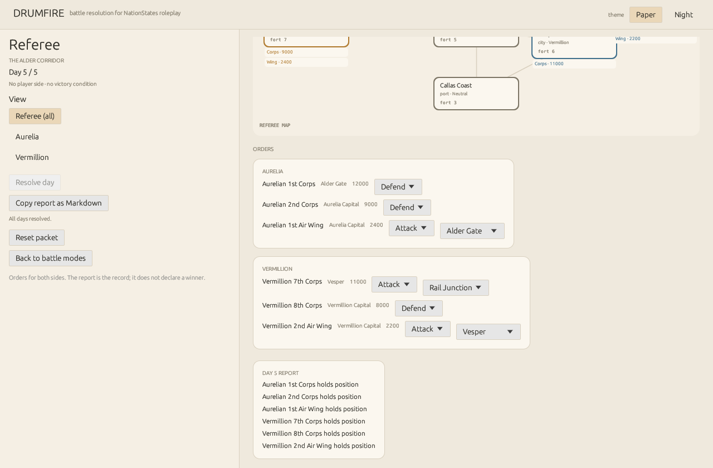

# Referee mode — roleplay conflict packet

Referee mode is not a player campaign. There is no player side, no victory
screen, and no fixed story. A referee supplies a scenario and order sheets, gets a
multi-day report, and uses it as the shared record for roleplay.

The first packet is **The Alder Corridor**: Aurelia vs Vermillion, seven zones,
five days, and two order sheets.



---

## 1. GUI referee console

```sh
cargo run -p drumfire-gui -- --demo-referee
```

The console provides:

- a connected-zone map with owners, forts, and unit chips;
- **Referee (all)**, **Aurelia**, and **Vermillion** views;
- per-unit order entry for both sides: Defend, Move, Attack, Recon, Resupply;
- target selectors for movement and attacks;
- **Resolve day** and **Copy report as Markdown**;
- the latest day's events, casualties, and control changes.

There is no player side and no victory screen. The view selector is an
information filter, not a faction login.

---

## 1. The packet

```text
referee-packet/
  scenario.json          # sides, zones, units, modules
  orders-aurelia.json    # Aurelia's orders
  orders-vermillion.json # Vermillion's orders
  conflict.log.json      # resolved day-by-day record
  report.md              # human-readable dispatch
```

Generate a fresh copy:

```sh
cargo run -p drumfire-cli -- referee packet referee-packet
```

Or resolve the built-in demo directly:

```sh
cargo run -p drumfire-cli -- referee demo
```

---

## 2. Workflow

1. **Set up the conflict** — edit `scenario.json`: nations, zones, routes, owners,
   capitals, units, terrain, forts, supply hubs, and modules.
2. **Collect orders** — edit `orders-<side>.json`. Both sides get the same days.
3. **Resolve** — run the simulation for the scenario and order sheets.
4. **Publish the record** — share `report.md` and/or `conflict.log.json` with the
   players.
5. **Advance** — change the scenario state from the log or start a new packet for
   the next phase.

Resolve manually:

```sh
cargo run -p drumfire-cli -- referee scenario --out my-war/scenario.json
cargo run -p drumfire-cli -- referee orders --out my-war
cargo run -p drumfire-cli -- referee resolve \
  --scenario my-war/scenario.json \
  --orders my-war/orders-aurelia.json \
  --orders my-war/orders-vermillion.json \
  --out my-war/conflict.log.json
cargo run -p drumfire-cli -- referee report my-war/conflict.log.json
```

---

## 3. Scenario

```json
{
  "name": "The Alder Corridor",
  "start_date": "2026-11-10",
  "max_days": 5,
  "modules": { "logistics": true, "intel": true },
  "sides": [
    {
      "id": "aurelia",
      "name": "Aurelia",
      "nation": "Aurelia",
      "capital_zone": "aurelia_capital"
    }
  ],
  "zones": [
    {
      "id": "alder_gate",
      "name": "Alder Gate",
      "kind": "city",
      "owner": "aurelia",
      "connections": ["aurelia_capital", "rail_junction"],
      "terrain": "plains",
      "fortification": 4,
      "supply_hub": false
    }
  ],
  "units": [
    {
      "id": "aurelia_1",
      "name": "Aurelian 1st Corps",
      "side": "aurelia",
      "branch": "ground",
      "zone": "alder_gate",
      "strength": 12000,
      "morale": 76,
      "supply": 82,
      "experience": 3
    }
  ]
}
```

Zone kinds: `capital`, `city`, `port`, `airbase`, `rail`, `countryside`.

Terrain: `plains`, `hills`, `urban`, `river`, `coast`. Terrain and fortification
favor the defender.

Units have a branch: `ground`, `air`, `naval`, or `reserve`. Ground units hold
and take ground; air and naval units currently add support strength.

---

## 4. Orders

```json
{
  "side": "aurelia",
  "orders": [
    { "day": 1, "unit": "aurelia_1", "action": { "type": "move", "to": "rail_junction" } },
    { "day": 1, "unit": "aurelia_air", "action": { "type": "recon" } },
    { "day": 3, "unit": "aurelia_1", "action": { "type": "attack", "target": "vesper" } },
    { "day": 4, "unit": "aurelia_1", "action": { "type": "defend" } },
    { "day": 5, "unit": "aurelia_1", "action": { "type": "resupply" } }
  ]
}
```

Actions:

- **Move** — enter an adjacent friendly or neutral zone. Entering an enemy zone
  triggers an engagement.
- **Attack** — force an engagement at an adjacent zone.
- **Defend** — hold position.
- **Recon** — detect adjacent enemy units and gain a little supply.
- **Resupply** — restore supply.

A unit can have one order per day. Duplicate orders are rejected.

---

## 5. Resolution

Each day:

1. Orders are collected for both sides.
2. Recon and resupply resolve.
3. Ground units move or attack.
4. Engagements run through the existing **Battle** engine with forces derived from
   the units, terrain, fortification, morale, experience, and air/naval support.
5. Casualties reduce unit strength; supply and morale are adjusted.
6. Supply is traced from owned capitals and supply hubs through owned zones.
7. Detection contacts are recorded for the report.

The report is not a score. It contains:

- day-by-day events;
- casualties by side and unit;
- control changes;
- recon contacts and strength estimates;
- logistics notes;
- final zone control and unit strengths.

No winner is declared. The referee and players decide what the outcome means.

---

## 6. Modules

Referee mode reuses the campaign module flags. The meaningful ones today:

- `logistics` — supply tracing and drain.
- `intel` — recon contacts; if off, the referee still sees the state.
- `manpower` — unit strength changes persist.
- `planes`, `ships` — future independent air/naval operations; currently support.
- `population`, `occupation`, `alliances`, and strategic weapons — reserved hooks.

---

## 7. Limitations

- Ground combat is a single Battle handoff, not a multi-day tactical battle.
- Air and naval units currently provide support rather than independent missions.
- The map is a connected-zone graph; there is no hex grid or continuous front.
- Supply is a simple BFS trace, not a full depot/convoy model.
- No economy, production, diplomacy, or civilian administration yet.
- The demo is a packet, not a fixed canon; edit the scenario and orders.

---

## 8. Why this shape

A roleplay supplement needs **plausible consequences and a shared record**, not a
win condition. The packet is deliberately small enough for a referee to run in one
session and detailed enough that the players can argue about the result.
